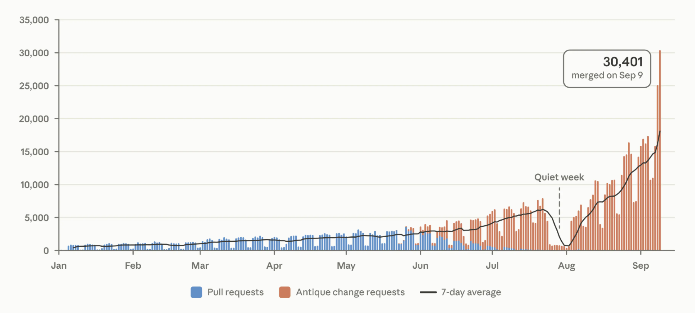
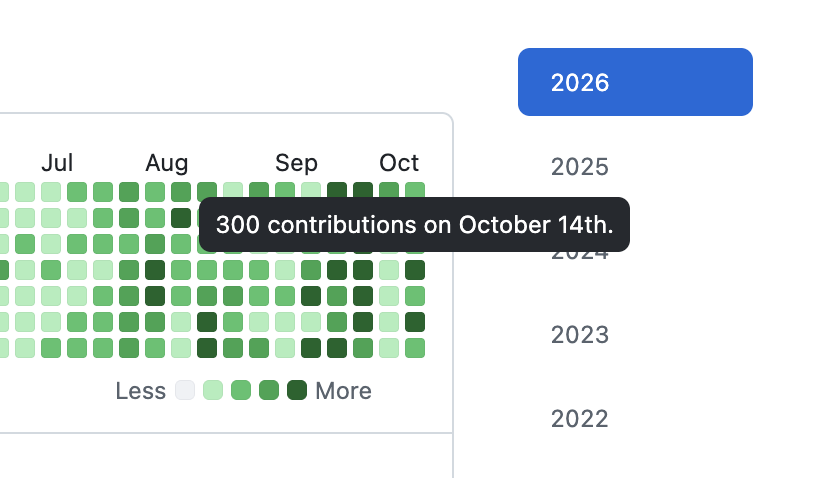

# The Red Queen

The Red Queen

Curt Grimm and Ken Smith put the red queen this way: "Here's the paradox: the more aggressively a firm competes, the greater its performance. But by competing so aggressively, it also forces its rivals to compete more aggressively, thus improving their performance. By being competitive — and thus successful — a firm also creates more competitive — and thus more successful — rivals for itself."

The red queen effect comes as term from biology, but originally the naming is based on the conversation between the Red Queen and Alice in Lewis Carroll’s Through the Looking Glass. The red queen says: "Here, you see, it takes all the running you can do, to keep in the same place. If you want to get somewhere else, you must run at least twice as fast as that!"

Similarities to the red queen can be observed in business. I came across this fascinating concept in a talk by Simon Wardley (the creator of Wardley maps — worth looking up). He pointed out keenly that the effect of agentic coding is clearly going to be a red queen effect.

One company becomes twice as effective at creating new features. The other companies have no choice but to follow. The rivals will try and outpace each other, and the red-queen-style cycle is snowballing.

You now have a large codebase. Get in some agents, 4X development pace. Then you will have a much larger codebase. Soon, you will know you want 10X. Then if all goes as projected by some, then you simply just speak out the requirements and out comes code. Simon Wardley said plainly: expect a billion lines of code. It just scales.

The ill fate is that the competition will do exactly the same. And there are many competitors on any given field of play. The rivalry is inevitable as always.

A famous [HBR article](https://hbr.org/2026/02/ai-doesnt-reduce-work-it-intensifies-it) a few months ago explored the work is getting more intense. Yep. Just take a guess where this all is going. A change is always a mixed bag of good and bad.

Sometimes concepts get invalidated by the "ad absurdum". *Ad absurdum* (Latin for "to the point of absurdity") is a form of argument, often called *reductio ad absurdum*, that proves a claim is false by demonstrating that its logical ultimate consequences lead to a ridiculous, impossible, or contradictory outcome. The ad absurdum refute is to follow the logic and find the inevitable impossibility.

I'm not at all sure if this red queen race ahead of us is a case of inevitable absurdum. Follow the logic of competition and scaling. What do you see?

Table stakes will be higher. While an agent can make a business from scratch in days in the future, I'm not sure if that is any good. Table stakes are those minimum things that need to be in place to be in business on a given playing field. For companies whose main business is through partners, building deeper and more technical connections between you and them might be a good idea. Old idea BTW.

One "absurdum" about the future is that 1000++ features in a product start to confuse the user more than add value. That is one clear place where the "let's just scale everything" projection leads to absurd outcomes.

What is clear: the abundance of products and startups will go through the roof. The marketplace will be crowded. Too many players for newcomers to stand out. A sort of table stakes too.

The race is speeding up

I take it we are at early phases of the exponential growth of the software. My latest two datapoints of calibration are from the frontier. 

The first months of the growth feel like linear. Assume that is months 1-9 on your agentic journey. Then you are 2X. Maybe 4X. The ceiling then is not even close. 

Anthropic software change volume has grown 5X summer 2026 -> October 2026. That literally is around 50% increase every month. 

*Source: [Anthropic, Redesigning source control](https://www.anthropic.com/engineering/redesigning-source-control)*

Lauren Tan (and also other team members) have been pushing 2000+ software changes a month. That is literally 100 changes per working day. Traditionally, we have managed 1-5 changes per day. 

*Source: [Lauren Tan on GitHub](https://github.com/poteto)* 

Hiding from the queen

I think Risto Siilasmaa would say to be the paranoid optimist about the future.

So, why am I writing this? I hope you assume the red queen is real. You will not hide.

At the same time, nobody will keep their sanity using the old ways of approaching this barrage of stuff, insights, features, and everything.

Why I'm writing this... as always... keep learning new skills and ways. Try understanding the future. Act on the future. (Again a nod to Risto Siilasmaa's thinking.)
